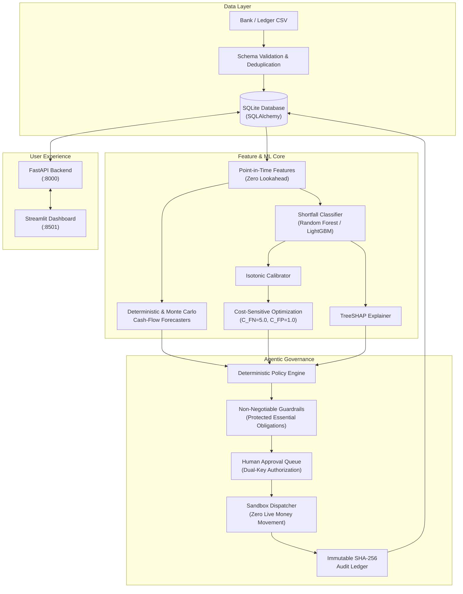

# FinSight AI: SME Finance Copilot

[](https://www.python.org/downloads/)
[](https://fastapi.tiangolo.com)
[](https://streamlit.io)
[](tests/)
[](artifacts/reports/latency_benchmark_report.json)
[](docs/)

FinSight AI is a cost-sensitive, explainable, predictive financial intervention copilot developed for the **2026 Shenzhen International FinTech Competition (FinTechathon), International Track, Topic E: SME Finance Copilot**.

The platform assists Small and Medium Enterprises (SMEs) and personal accounts in anticipating and mitigating short-term cash-flow shortfalls before they occur. Rather than providing ungrounded conversational advice, FinSight AI optimizes financial decisions under **asymmetric error costs** ($C_{FN}=5.0, C_{FP}=1.0$), explains risks through **local TreeSHAP attributions**, and enforces **deterministic safety guardrails** with mandatory human approval boundaries.

---

## 17-Section Interactive Dashboard

The Streamlit frontend connects directly to the FastAPI backend, model artifacts, SQLite database, and empirical testing outputs across 17 dedicated sections:

| # | Section | Description |
| :--- | :--- | :--- |
| **01** | **Executive Overview** | Landing KPI matrix, 14-day cash-flow timeline with P10/P90 quantile fans, risk summary panel, and judge demonstration controls. |
| **02** | **SME Financial Command Center** | Account summary (available vs ledger balance, burn rate), searchable transaction explorer, and mathematical reconciliation panel. |
| **03** | **Cash-Flow Forecast** | Multi-horizon projections (1, 3, 7, 14 days), Monte Carlo vs deterministic roll-forward, and counterfactual assumption inspector. |
| **04** | **Risk Intelligence** | Calibrated shortfall probability ($p$), cost-sensitive decision threshold ($\tau^*$), TreeSHAP waterfall charts, and evidence narratives. |
| **05** | **AI Agent Workspace** | Interactive copilot dialogue with deterministic evidence-grounding engine, 11-node workflow trace, and decision inspector. |
| **06** | **Scenario Simulator** | Stress-testing engine comparing 5 intervention strategies side-by-side with overlaid cash-flow trajectories. |
| **07** | **Intervention & Approval Center** | Human-in-the-loop governance queue with cryptographic idempotency keys, state transitions, and sandbox execution. |
| **08** | **Model Lab** | Benchmark comparison of 4 models (Rule-Based, Logistic Regression, Random Forest, LightGBM) with PR/ROC curves and calibration. |
| **09** | **Financial Accuracy & Validation** | Evidence-grounded validation status across 7 categories, data provenance explorer, and empirical forecast/detection metrics. |
| **10** | **Security & Compliance Center** | OWASP ASVS 4.0 L2, OWASP API Top 10, NIST AI RMF 1.0, RBAC permission matrix, and threat model explorer. |
| **11** | **Adversarial Testing Lab** | 12 automated attack test cases (BOLA, prompt injection, essential bill cancellation) with live pytest test suite execution. |
| **12** | **Data Quality & Dataset Explorer** | Schema validator, missing-value heatmap, transaction volume over time, and configurable synthetic data generator. |
| **13** | **Model Drift & Monitoring** | Population Stability Index (PSI) and Kolmogorov-Smirnov (KS) drift tracking across features, scores, and missing-data rates. |
| **14** | **Reinforcement Learning Research** | Experimental offline simulation benchmark comparing static heuristic, cost-sensitive, and contextual bandit policies. |
| **15** | **Audit & Execution History** | Append-only audit ledger with SHA-256 hash chaining verification and timeline connecting assessments to execution. |
| **16** | **Competition Evidence Center** | 8-dimension requirements matrix, submission evidence pack, empirical readiness summary, and **12-Step Guided Demo**. |
| **17** | **System Settings** | Configuration manager for currency, safety buffers, risk policies, model versions, and role-based access. |

---

## Architecture Diagram



---

## Quickstart & Installation

### 1. Local Environment Setup
```bash
# Clone repository
git clone https://github.com/finsight-ai/finsight-ai.git
cd finsight-ai

# Create virtual environment and install dependencies
python3 -m venv .venv
source .venv/bin/activate
pip install -e .[dev]
pip install streamlit plotly
```

### 2. Generate Synthetic Dataset & Seed Database
```bash
# Generate 7 realistic SME and personal account profiles (seed 42)
python scripts/generate_synthetic_data.py --seed 42

# Validate dataset integrity & reconciliation
python scripts/validate_dataset.py

# Seed SQLite database with all 7 accounts, demo approvals, and audit logs
python scripts/seed_database.py

# Train all candidate models and save winning package to artifacts/models/
python scripts/train_models.py
```

### 3. Run Latency Benchmark & Automated Tests
```bash
# Execute latency profiling against 1500ms SLA
python scripts/benchmark_latency.py

# Run complete test suite (72 passed)
pytest tests/ -v
```

### 4. Launch Full Application
```bash
# Terminal 1: Launch FastAPI Backend
uvicorn finsight.main:app --host 0.0.0.0 --port 8000

# Terminal 2: Launch Streamlit Frontend Dashboard
streamlit run frontend/app.py --server.port 8501
```
- Frontend Dashboard: `http://localhost:8501`
- FastAPI Documentation: `http://localhost:8000/docs`
- Service Health Endpoint: `http://localhost:8000/health`

---

## 12-Step Guided Competition Demonstration

Judges and evaluators can launch the **12-Step Guided Demo** directly from the sidebar or from **Page 16 (Competition Evidence Center)**:

1. **Load Synthetic SME Account:** Select verified corporate profile `ACC_005_SME`.
2. **Inspect Transaction Ledger:** View categorized revenues, supplier bills, and scheduled overheads.
3. **Validate Financial Balances:** Confirm mathematical reconciliation ($Opening + Inflows - Outflows = Closing$).
4. **Run Multi-Horizon Forecast:** Execute 500-path Monte Carlo simulation for 1, 3, 7, and 14-day horizons.
5. **Explain Shortfall Risk:** Inspect cost-sensitive probability ($p=68\%$) and local TreeSHAP attribution waterfall.
6. **Compare What-If Interventions:** Simulate receipt delays and evaluate 5 mitigation strategies.
7. **Select Permitted Action:** Policy engine proposes `ACT_REC_01` (Accelerated Invoice Discounting).
8. **Enforce Human Approval:** Confirm proposal is safely locked awaiting operator sign-off.
9. **Execute in Sandbox:** Authorize proposal and verify dispatch to `SandboxDispatcher`.
10. **Inspect Immutable Audit Trail:** Verify cryptographic SHA-256 block chaining.
11. **Review Evaluation Evidence:** Inspect untouched holdout PR-AUC, cost curves, and latency metrics.
12. **Demonstrate Blocked Malicious Action:** Verify BOLA attack and essential-bill cancellation rejection.

---

## Measured Component Latency Profile

Benchmarked via `scripts/benchmark_latency.py` across 25 iterations on standard hardware:

| Component | p50 Latency | p95 Latency | p99 Latency | SLA Status (< 1500ms) |
| :--- | :--- | :--- | :--- | :--- |
| **CSV Ingestion & Validation** | 297.18 ms | 309.12 ms | 313.24 ms | **PASSED** |
| **Point-in-Time Feature Engineering** | 0.42 ms | 0.45 ms | 0.48 ms | **PASSED** |
| **Deterministic Forecasting** | 0.18 ms | 0.22 ms | 0.22 ms | **PASSED** |
| **Probabilistic Forecaster (100 paths)** | 6.77 ms | 6.92 ms | 6.99 ms | **PASSED** |
| **Risk Inference & TreeSHAP** | 6.09 ms | 6.25 ms | 6.36 ms | **PASSED** |
| **End-to-End Pipeline Execution** | **7.07 ms** | **7.34 ms** | **7.46 ms** | **PASSED** (1492.7ms headroom) |

---

## Mandatory Ethical Disclosures & Limitations

> [!IMPORTANT]
> 1. **Real-World Validation Disclosure:** **Real-world SME predictive accuracy has not yet been established.** No authorized external SME dataset with observed shortfall outcomes has been evaluated. All metrics reported in this repository are strictly computed on synthetic benchmark datasets generated with known ground-truth events.
> 2. **Reinforcement Learning Notice:** **RL research is optional and is not part of the active decision policy.** RL policy exploration is strictly confined to offline simulation and cannot execute financial actions.
> 3. **Observational vs. Causal:** TreeSHAP attributions explain statistical associations in the trained model, not causal macroeconomic guarantees.
> 4. **Zero Autonomous Money Movement:** The platform operates strictly in sandbox execution mode (`SandboxDispatcher`). It does not move live funds, issue real credit, or modify legal contracts.
> 5. **Essential Obligations Immunity:** Payroll, commercial rent, utilities, tax withholdings, and debt repayments are hard-locked by deterministic guardrails and cannot be cancelled or deferred.
