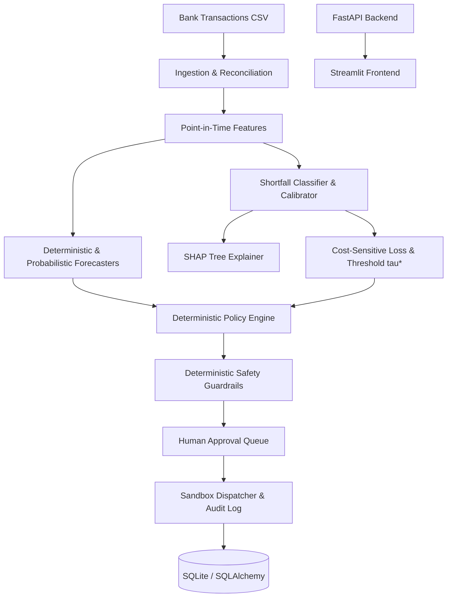

# FinSight AI: Cost-Sensitive, Explainable, Predictive Financial Intervention Agent

[](https://www.python.org/downloads/)
[](https://fastapi.tiangolo.com)
[](https://streamlit.io)
[](tests/)
[](tests/)
[](scripts/benchmark_latency.py)

FinSight AI is a cost-sensitive, explainable financial intervention system designed to assist personal and SME banking customers (with native multi-currency support prioritizing Bangladeshi Taka, **BDT**) in anticipating and mitigating short-term cash-flow shortfalls before they occur.

Rather than merely displaying historical charts or generating unconstrained conversational advice, FinSight AI optimizes financial decisions under **asymmetric error costs** ($C_{FN}=5.0, C_{FP}=1.0$), explains risks through **local SHAP attributions**, and enforces **deterministic safety guardrails** with mandatory human approval boundaries.

---

## Key System Features

1. **Transaction Ingestion & Reconciliation Pipeline (`src/finsight/ingestion/`)**:
   - Timezone-aware timestamp validation (`Asia/Dhaka`).
   - Cryptographic transaction deduplication (ID and content hashing).
   - Balance audit equation: $\text{Opening Balance} + \sum \text{Inflows} - \sum \text{Outflows} = \text{Closing Balance}$.
   - Automatic flagging of internal self-transfers to prevent double-counting expenditure or income.
2. **Point-in-Time Feature Engineering (`src/finsight/features/`)**:
   - Pure causal feature extraction strictly prior to prediction timestamp $T$ (zero lookahead leakage).
   - Spending velocity ratios, rolling volatility, recurring bill detection, days of solvency runway, and cold-start indicators.
3. **Cash-Flow Forecasting (`src/finsight/forecasting/`)**:
   - Dual-track projections across 1, 3, 7, and 14-day horizons.
   - Deterministic bill roll-forward paired with 500-iteration probabilistic Monte Carlo quantiles ($P_{10}, P_{50}, P_{90}$).
4. **Cost-Sensitive Supervised ML & Calibration (`src/finsight/ml_core/`)**:
   - Random Forest, LightGBM, Logistic Regression, and Rule-Based Runway Baselines.
   - Probability calibration fitted strictly on validation holdouts (Isotonic and Sigmoid).
   - Optimal threshold selection $\tau^*$ minimizing empirical expected cost under $C_{FN}=5.0, C_{FP}=1.0$.
5. **Local Explainability (`explainability.py`)**:
   - SHAP TreeExplainer attributions decomposed into top risk drivers, risk mitigators, and human-readable causal limitation disclaimers.
6. **Deterministic Decision Engine & Policy Guardrails (`src/finsight/decision/`)**:
   - Expected financial cost minimization formula:
     $$\mathbb{E}[\text{Cost}(a \mid p)] = (1 - p) C_{\text{unnecessary}, a} + p (1 - \alpha_a) C_{FN} + C_a$$
   - **Hard Rule**: Essential recurring obligations (rent, mortgage, utilities, taxes, debt repayment, healthcare, payroll) can **NEVER** be paused, delayed, or cancelled.
   - **Hard Rule**: Zero real money movements or credit underwriting. All prototype execution is sandboxed.
7. **Human Approval Workflow (`src/finsight/execution/`)**:
   - State machine: `PROPOSED -> PENDING_APPROVAL -> APPROVED / REJECTED -> EXECUTED_IN_SANDBOX`.
   - Append-only audit logging recording actors, policy versions, and execution outcomes.
8. **Interactive Full-Stack Architecture**:
   - High-performance FastAPI backend with typed OpenAPI schemas.
   - Beautiful 6-page Streamlit dashboard (Overview, Cashflow Forecast, Risk Explanations, Recommendations, Approvals, Model Evaluation).

---

## Architecture Diagram



---

## Quickstart & Installation

### 1. Local Environment
```bash
# Clone and enter workspace
git clone https://github.com/finsight-ai/finsight-ai.git
cd finsight-ai

# Create virtual environment (Python 3.12 recommended)
python3 -m venv .venv
source .venv/bin/activate

# Install dependencies
pip install -e .
```

### 2. Generate Synthetic Dataset & Train Models
```bash
# Generate 7 realistic account profiles (Stable Salary, Irregular, Spending Spike, Delayed Salary, SME, Cold Start, Edge Cases)
python scripts/generate_synthetic_data.py --seed 42

# Validate dataset integrity & balance reconciliation
python scripts/validate_dataset.py

# Train and evaluate all 4 model variants using temporal splits
python scripts/train_models.py
```

### 3. Run Latency Benchmark & End-to-End Demo
```bash
# Profile components against the 1.5s SLA target
python scripts/benchmark_latency.py

# Run single-command CLI demo walkthrough
python scripts/run_demo.py --account ACC_003_SPIKE
```

---

## Running the Web Application

### Option A: Local Execution
Terminal 1 (Backend API):
```bash
source .venv/bin/activate
uvicorn finsight.main:app --host 0.0.0.0 --port 8000 --reload
```
- FastAPI Docs: `http://localhost:8000/docs`
- Health Endpoint: `http://localhost:8000/health`

Terminal 2 (Frontend Dashboard):
```bash
source .venv/bin/activate
streamlit run frontend/app.py --server.port 8501
```
- Streamlit Interface: `http://localhost:8501`

### Option B: Docker Compose
```bash
docker compose up --build
```

---

## Validation & Test Suite

The test suite contains **65 automated tests** covering unit logic, integration endpoints, security guardrails, and temporal splitting:

```bash
# Run complete test suite
pytest tests/ -v

# Run with statement coverage report
pytest tests/ --cov=finsight --cov-report=term-missing
```

### Test Suite Summary:
- **Unit Tests (17 tests)**: Point-in-time features, zero-division safety, cold-start flags, cash-flow roll-forward, probabilistic quantiles, forecast metrics, cost-sensitive matrices, calibration bounds, policy engine ranking.
- **Integration Tests (10 tests)**: CSV upload, schema rejection, duplicate handling, internal transfer reconciliation, account summaries, forecasts, risk assessment, SHAP explanations, recommendation generation, approval lifecycle, idempotency.
- **Security Tests (36 tests)**: Multi-tenant account isolation, rate-limiting token bucket, protection of all 12 essential categories against cancellation and pause, rejection of live money movement, prompt injection sanitization, deterministic policy immunity.
- **Evaluation Tests (2 tests)**: Mathematical zero lookahead leakage, strict chronological time ordering ($\max(t_{\text{train}}) < \min(t_{\text{val}}) < \min(t_{\text{test}})$).
- **Result:** **65 passed, 0 failed, 81% overall coverage**.

---

## Measured Component Latency

Benchmarked across 25 runs on standard hardware (`scripts/benchmark_latency.py`):

| Component | p50 Latency | p95 Latency | p99 Latency | SLA Status (< 1500ms) |
| :--- | :--- | :--- | :--- | :--- |
| **CSV Ingestion & Validation** | 455.58 ms | 558.92 ms | 611.59 ms | **PASSED** |
| **Point-in-Time Feature Extraction** | 0.48 ms | 0.85 ms | 1.76 ms | **PASSED** |
| **Deterministic Forecasting** | 0.23 ms | 0.42 ms | 0.57 ms | **PASSED** |
| **Probabilistic Forecaster (100 paths)**| 8.30 ms | 11.18 ms | 12.46 ms | **PASSED** |
| **Risk Inference & Tree SHAP** | 16.87 ms | 31.23 ms | 40.50 ms | **PASSED** |
| **End-to-End Agent Graph Pipeline** | **17.58 ms** | **20.57 ms** | **21.09 ms** | **PASSED** (1479ms headroom) |

---

## Limitations & Disclaimers

> [!IMPORTANT]
> 1. **Synthetic Data Provenance**: All evaluation metrics reported in this repository are computed on synthetic simulated data generated by `scripts/generate_synthetic_data.py`. No real customer bank data was used.
> 2. **Zero External Validation**: This system has **NOT** been piloted or validated on real banking customers or live production accounts.
> 3. **Observational vs. Causal**: SHAP values explain model associations, not causal real-world economics.
> 4. **No Financial Movement**: The prototype operates strictly in sandbox simulation mode. It does not move funds, grant credit, or cancel legal obligations.
